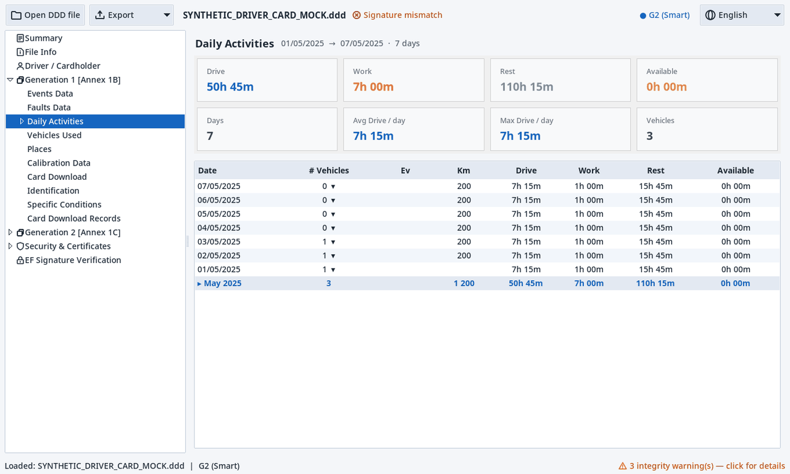

# DDD Tachograph Reader

<p align="center">
  
</p>

> Open Source  `.ddd` digital tachograph file analyzer — full decoding with tree-structured data exploration.

[](https://github.com/Syax89/DDDTachograph_Reader/actions/workflows/build.yml)
[](https://github.com/Syax89/DDDTachograph_Reader/releases/latest)
[](LICENSE)


---

## Features

### File Decoding
- **Multi-generation**: G1 (Annex 1B), G2 Smart (Annex 1C), **Gen 2.2 Smart V2** (Reg. EU 2023/980)
- **Driver data**: Surname, first name, date of birth, card number, expiry, issuing nation
- **Daily activities**: Driving, work, availability, rest/break
- **Vehicle data**: VIN, plate, registration nation, odometer
- **GNSS positions**: Coordinates, border crossings, places
- **VU records**: Card insertions/withdrawals, calibrations, sensors, events/faults
- **Per-day vehicles**: Vehicle(s) driven each day shown in the driver activity chart
- **Full nation names**: Registration/issuing/sensor nation codes expanded to English names

### Integrity
- Cryptographic signature verification (ERCA → MSCA → Card/VU chain)
- Recursive BER-TLV and STAP parsing (nested containers)
- 100% byte coverage on all tested files
- TREP completeness inventory and origin detection (driver card vs VU download)
- Plausibility gating and best-effort salvage of partial/corrupted downloads
- Tree structure for data exploration

### Export
- PDF, Excel, CSV, JSON export
- Interactive GUI with tree navigation

---

## Product Tour

<p align="center">
  
</p>

<p align="center"><sub>Activity dashboard · daily activity timeline · speed dashboard · detailed speed graph</sub></p>


<details>
<summary>Open the full-resolution screenshots</summary>

1. [Activity dashboard](docs/screenshots/01_activity_dashboard.png)
2. [Daily activity timeline](docs/screenshots/02_activity_timeline.png)
3. [Speed dashboard](docs/screenshots/03_speed_dashboard.png)
4. [Detailed speed graph](docs/screenshots/04_speed_graph.png)
</details>

---

## Download & Usage

### Pre-built Executable (recommended)
Download from the **[Releases](https://github.com/Syax89/DDDTachograph_Reader/releases/latest)** page:

| Platform | File |
|----------|------|
| Windows | `TachoReader-v<version>-windows-x64.zip` |
| macOS | `TachoReader-v<version>-macos.dmg` |
| Linux (x86_64) | `TachoReader-v<version>-linux-x86_64.flatpak` |

Extract the Windows archive and run `TachoReader.exe`. Open the macOS disk image
and drag `TachoReader.app` to Applications. For Linux, see below.

### Linux (Flatpak, x86_64)

Releases containing the Linux packaging job also ship a standalone Flatpak
bundle, produced by CI using the same `build.spec` configuration as the native
Windows and macOS builds:

```bash
flatpak install --user ./TachoReader-vX.Y.Z-linux-x86_64.flatpak
flatpak run io.github.Syax89.TachoReader
```

Replace `vX.Y.Z` with the downloaded release version. For a CI build, extract
the artifact ZIP and install the contained `TachoReader-linux-x86_64.flatpak`.

> **Availability:** the Flatpak bundle is not part of the already-published
> `v2.7.1` release — it appears with the next tagged release that includes the
> Linux packaging job.

The bundle is self-contained: Python, Tk and every Python dependency live inside
it, and only the `org.freedesktop.Platform` 25.08 runtime is fetched (from
Flathub) as a dependency.

**Sandbox permissions**

| Permission | Why |
|------------|-----|
| `--filesystem=home` | Tk's own file dialogs are plain X11 dialogs, not portal pickers, so opening `.ddd` files and saving exports needs read/write access to your home directory. |
| `--socket=x11`, `--share=ipc` | Tk is an X11 toolkit with no Wayland-native backend. |
| no network, no host filesystem | The reader never talks to the network, and files outside your home directory are not reachable. |

**Opening files outside your home directory** (USB sticks, mounted drives,
`/mnt`, ...) requires an explicit override, for example:

```bash
flatpak override --user --filesystem=/run/media/$USER io.github.Syax89.TachoReader
```

**Wayland:** the app runs on the X11 socket, so Wayland sessions need XWayland
(`xorg-xwayland` on most distributions, shipped by default by current desktops).

**Limitations**

- **x86_64 only** — release CI produces a single `linux-x86_64` bundle; there is
  no aarch64/ARM build.
- **Not Flathub-listed** — the bundle is a standalone download and is
  **not updated automatically**: installing a
  newer release file is a manual step.
- It is an unsigned local bundle, so Flatpak installs it as a sideload rather
  than from a verified remote.

### From Source (developers)

```bash
git clone https://github.com/Syax89/DDDTachograph_Reader.git
cd DDDTachograph_Reader
pip install -r requirements.txt

# GUI
python app/gui.py

# CLI
python app/cli.py path/to/file.ddd
```

---

## Project Structure

```
DDDTachograph_Reader/
├── app/
│   ├── cli.py                  # Command-line interface
│   ├── main.py                 # CLI compatibility entry point
│   ├── gui.py                  # GUI (tree + table, tkinter)
│   ├── engine.py               # TachoParser entry point
│   └── export.py               # PDF/Excel/CSV/JSON export
├── core/
│   ├── decoders/                # Field-level decoders and primitives
│   ├── parser/                  # Deterministic, G1, and VU parsers
│   ├── registry/                # Decoder registry and result models
│   ├── crypto/                  # Certificate and signature validation
│   └── utils/                   # Shared helpers, constants, and version
├── certs/                       # ERCA root certificates
├── flatpak/                     # Flatpak manifest + desktop entry (Linux bundle)
├── tests/                       # Test suite
├── scripts/                     # Specifications and audits
├── docs/                        # Documentation
└── .github/workflows/           # CI/CD (lint, tests, Windows/macOS/Linux builds)
```

---

## Supported Formats

| Generation | Standard | Header | Notes |
|------------|----------|--------|-------|
| G1 Digital | Annex 1B (Reg. 3821/85) | variable | Legacy tachographs |
| G2 Smart | Annex 1C (Reg. 2016/799) | `0x7621` | Smart Tachograph V1 |
| **G2.2 Smart V2** | Annex 1C (Reg. 2023/980) | `0x7631` | Smart Tachograph V2 |

---

## Languages

The interface ships in 34 languages: English plus the 24 official EU languages,
Norwegian, Icelandic, Russian, Ukrainian, Belarusian, Turkish, Serbian, Bosnian,
Albanian and Macedonian. Pick one from the **Language** menu in the top bar; the
choice is stored in the per-user settings file and applied at the next start.

English is the source language and the default. The application's own text —
menus, column headers, section names, messages — is translated. Labels *decoded
from the file* (activity names, event and fault descriptions, record purposes,
specific conditions, country names, signature statuses) are shown exactly as the
decoder names them unless **Translate file contents** at the bottom of the
Language menu is ticked. Free text carried by the file (driver names, plates,
addresses, company names), identifiers and codes are never translated, nor are
exported reports. See [CONTRIBUTING.md](CONTRIBUTING.md) to add a language or
improve a translation.

---

## Testing

```bash
pip install -r requirements.txt
python -m pytest tests/ -v
```

The suite covers multi-generation detection, G1/G2/G2.2 parsing, byte coverage,
fuzzing, and digital signatures. Tests requiring private DDD samples skip when
those fixtures are unavailable.

### Continuous Integration

What runs depends on what you do:

| Trigger | What happens |
|---------|--------------|
| **Local commit** (`git commit`) | Nothing — no remote CI runs until you push |
| **Push to any branch** or pull request | Both build and test workflows: all three platforms and their smoke checks, plus lint, translations, tests and semantic coverage |
| **Manual run** | Select **Build TachoReader** for all three platforms and smoke checks, or **Tests** for lint, translations, tests and semantic coverage; the workflows are independent |
| **Push a `v*` tag** | The release workflow: version check, lint, pytest, the three platform builds, then a single publisher |

Matrix fail-fast is disabled, so one platform failing does not cancel another.
**All platforms verified** passes only when all three platform builds succeed;
failed, cancelled or skipped builds fail the gate. Linux checks include
installation of the exported Flatpak and a real GUI window under Xvfb. The
separate release workflow starts publication only after all three platform jobs
succeed and the exact three non-empty packages (zip, dmg, flatpak) are present.

A branch/PR build uploads ordinary Actions artifacts (`TachoReader-windows-latest`,
`TachoReader-macos-latest`, `TachoReader-linux-x86_64`): the frozen Windows/macOS
build folder / macOS `.app` (not a release zip/dmg) and the exported Linux
`.flatpak`. Download them from the workflow run's **Artifacts** section and
extract the artifact ZIP first. They expire after a retention period; tagged
releases provide the versioned zip/dmg/flatpak files on the Releases page.

Full trigger table, job breakdown and release gate:
[docs/developer/testing.md](docs/developer/testing.md#ci-builds-and-releases).

---

## Building from Source

```bash
pip install pyinstaller
pyinstaller build.spec
# Windows: dist/TachoReader/TachoReader.exe
# macOS: dist/TachoReader.app
# Linux: dist/TachoReader/TachoReader
```

On Linux the frozen `dist/TachoReader` directory can be packaged as a Flatpak
(the same manifest CI uses):

```bash
flatpak-builder --user --force-clean --repo=flatpak-repo \
  flatpak-build flatpak/io.github.Syax89.TachoReader.yml
```

---

## License

MIT © [Syax89](https://github.com/Syax89)

---

## Acknowledgments & Support

Thank you to everyone who has used, tested, and contributed to this project.
Your feedback and support keep it moving forward.

This project **is and will remain open source** and free to use. If it has been
useful to you and you'd like to say thanks, you can buy me a coffee — completely
optional, but always appreciated.

<p align="center">
  <a href="https://buymeacoffee.com/syax89" target="_blank">
    
  </a>
</p>
